<div align="center">


# Amane

**面向个人影音库的多源元数据管理、整理与自动化服务**

多源刮削 · 字段级择优 · 本地数据所有权 · STRM · 任务与订阅 · AI 智能体 · Emby / Jellyfin

[](https://github.com/ZiPenOk/Amane/releases)
[](https://github.com/ZiPenOk/Amane/pkgs/container/amane)
[](LICENSE)

[安装说明](docs/installation.md) · [浏览器脚本](docs/browser-script.md) · [快速开始](docs/quickstart.md) · [版本差异](docs/differences.md) · [文档目录](docs/README.md) · [下载](https://github.com/ZiPenOk/Amane/releases)

</div>

---

> [!IMPORTANT]
> 本仓库是 Amane 的**发行与用户文档仓库**。
>
> - 上游开源项目：[sqzw-x/amane](https://github.com/sqzw-x/amane)
> - 容器镜像：`ghcr.io/zipenok/amane`
>
> 桌面版、Android 与 CLI 产物通过本仓库 Releases 发布。

## Amane 是什么

Amane 是一个以影片条目为核心的个人影音库元数据服务。

它负责从多个来源抓取、合并和管理元数据，并可按需把结果整理为 NFO、海报、封面、剧照和字幕；Emby / Jellyfin 继续负责媒体文件管理、播放与串流。

Amane **不是** Emby / Jellyfin 的替代品，而是它们的元数据补充，也可以完全独立地作为番号资料库使用。

<picture>
  <source media="(prefers-color-scheme: dark)" srcset="assets/screenshots/meta-wall-dark.webp">
  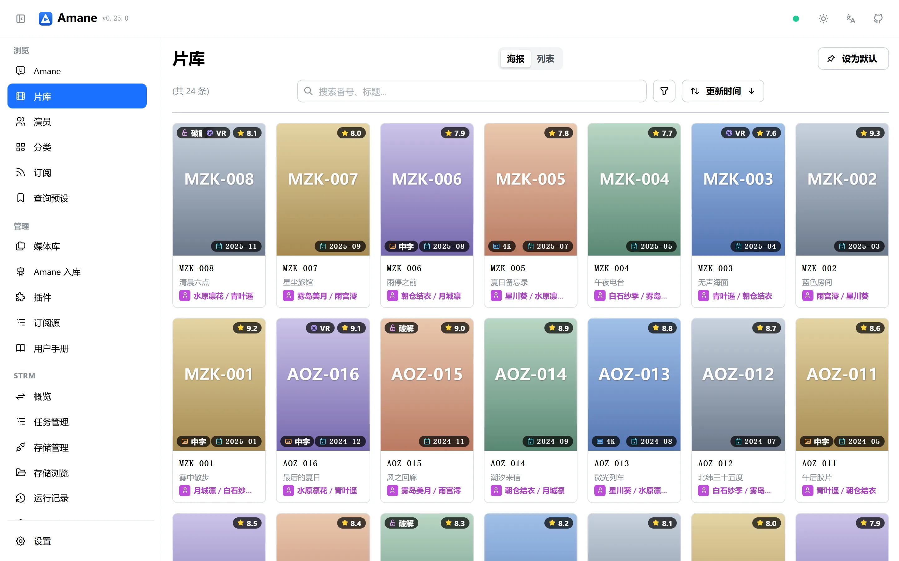
</picture>

## 主要能力

| 能力 | 说明 |
|---|---|
| **多源字段聚合** | 按内容类型配置站点顺序，每个字段可单独设置优先级或排除来源 |
| **保留原始数据** | 站点原始快照、图片和译文保存在本地 SQLite 与资源目录，来源下线后仍可查看历史数据 |
| **可审计的元数据管理** | 对比来源、字段锁定、分类治理、评论、用户标签、逐字段修订 |
| **丰富的番号来源** | 手动提交、模板批量生成、RSS / Atom 订阅、定时重新刮削、媒体库扫描、智能体与 CLI |
| **媒体库与 STRM** | 本地文件扫描、115 入库、STRM 生成、批量命名、路径模板、整理与删除任务 |
| **Emby / Jellyfin 衔接** | 整理完成后写入 NFO、图片与字幕；支持刷新媒体库、演员资料与头像推送 |
| **AI 智能体** | 在应用内用自然语言查询、整理标签、提交刮削；外部智能体可通过 CLI 操作 |
| **语义检索** | 使用本地向量索引检索封面与剧照 |
| **多端访问** | macOS / Windows 桌面应用、Docker 服务端、Android 客户端与浏览器访问 |

## 与上游原版的差异

本发行版跟随上游 Amane 的功能基础，同时加入了面向 115、STRM、播放和整理工作流的增强。

| 方向 | 本发行版的主要差异 |
|---|---|
| **115 / Amane 入库** | 提供从 115 认证、存储浏览、已有文件导入、离线下发、远端整理到 STRM / Emby 收尾的完整工作流，并支持按媒体库配置命名模板 |
| **浏览器脚本入库** | 通过 JAV 老司机脚本从 115 文件页或 JavBus / JavDB / JavLibrary 直接提交 Amane 入库任务 |
| **STRM 管理** | 独立管理连接、计划、运行和逐条日志；支持 TMDB 识别、批量改名预览、两阶段执行、撤销、终止与残留清理 |
| **媒体修正** | 可统一修正发布标记、条目类型、115 远端路径、本地 STRM、NFO / 图片和 Emby 映射 |
| **播放与字幕** | 支持 STRM 直连播放、Emby 302 网关、字幕搜索、预览、加载、下载和位置调整 |
| **数据源与翻译** | 增加 JavDB App API、官方无码来源、演员头像缩略图缓存，以及 Google / Bing / DeepL 等翻译回退 |
| **界面与性能** | 媒体库主从式设置、手动排序、STRM 工作台、任务运行日志终端、热门查询与 Watcher 子树查询优化 |

更完整的对比见 **[与上游原版的主要区别](docs/differences.md)**。

> 页面中的影片、演员、制作商、评分和评论均为虚构的离线演示数据。

## 界面预览

<table>
 <tr>
 <td width='50%'>
 <picture>
 <source media='(prefers-color-scheme: dark)' srcset='assets/screenshots/movie-detail-dark.webp'>
 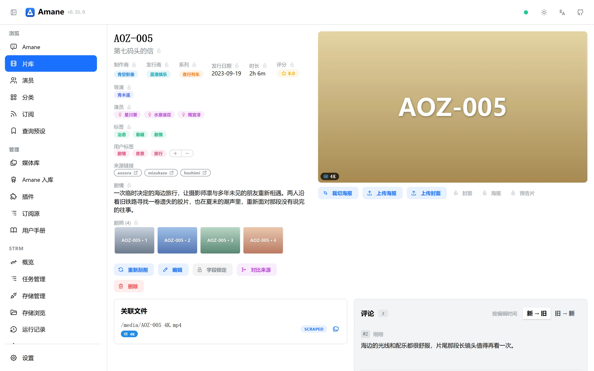
 </picture>
 <br><sub>影片详情：多来源字段、用户标签、关联文件与评论</sub>
 </td>
 <td width='50%'>
 <picture>
 <source media='(prefers-color-scheme: dark)' srcset='assets/screenshots/actor-dark.webp'>
 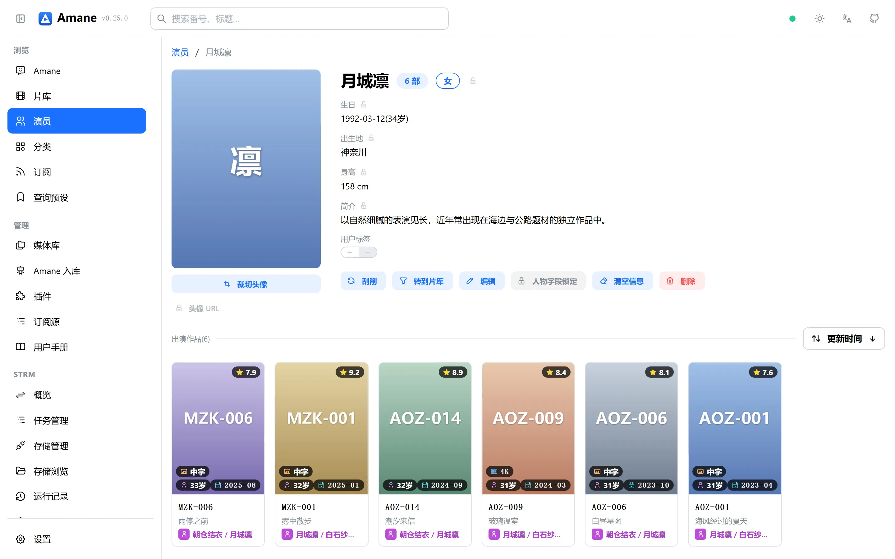
 </picture>
 <br><sub>演员详情：资料、头像、简介与出演作品</sub>
 </td>
 </tr>
 <tr>
 <td width='50%'>
 <picture>
 <source media='(prefers-color-scheme: dark)' srcset='assets/screenshots/tasks-dark.webp'>
 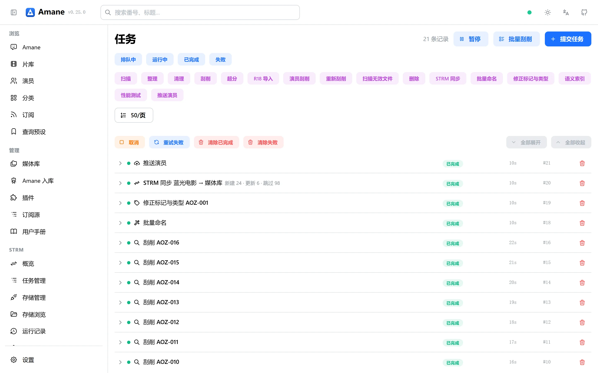
 </picture>
 <br><sub>任务中心：STRM 同步、批量命名、媒体修正与演员推送</sub>
 </td>
 <td width='50%'>
 <picture>
 <source media='(prefers-color-scheme: dark)' srcset='assets/screenshots/amane-settings-dark.webp'>
 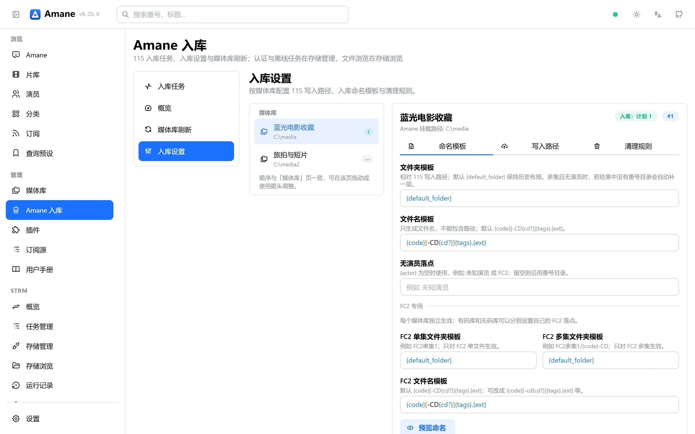
 </picture>
 <br><sub>Amane 入库：按媒体库配置命名、写入路径与清理规则</sub>
 </td>
 </tr>
 <tr>
 <td width='50%'>
 <picture>
 <source media='(prefers-color-scheme: dark)' srcset='assets/screenshots/library-list-dark.webp'>
 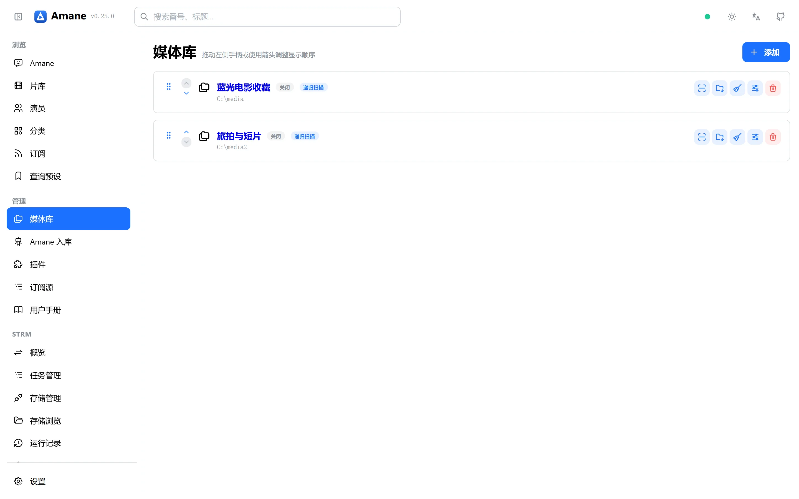
 </picture>
 <br><sub>媒体库工作台：拖拽排序与统一操作入口</sub>
 </td>
 <td width='50%'>
 <picture>
 <source media='(prefers-color-scheme: dark)' srcset='assets/screenshots/strm-overview-dark.webp'>
 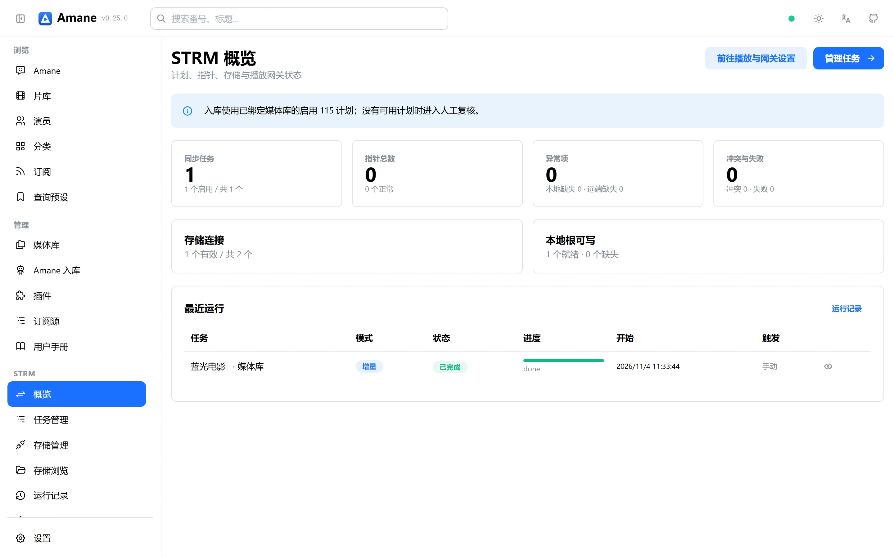
 </picture>
 <br><sub>STRM 概览：计划、连接、指针健康度与最近运行</sub>
 </td>
 </tr>
 <tr>
 <td width='50%'>
 <picture>
 <source media='(prefers-color-scheme: dark)' srcset='assets/screenshots/strm-runs-dark.webp'>
 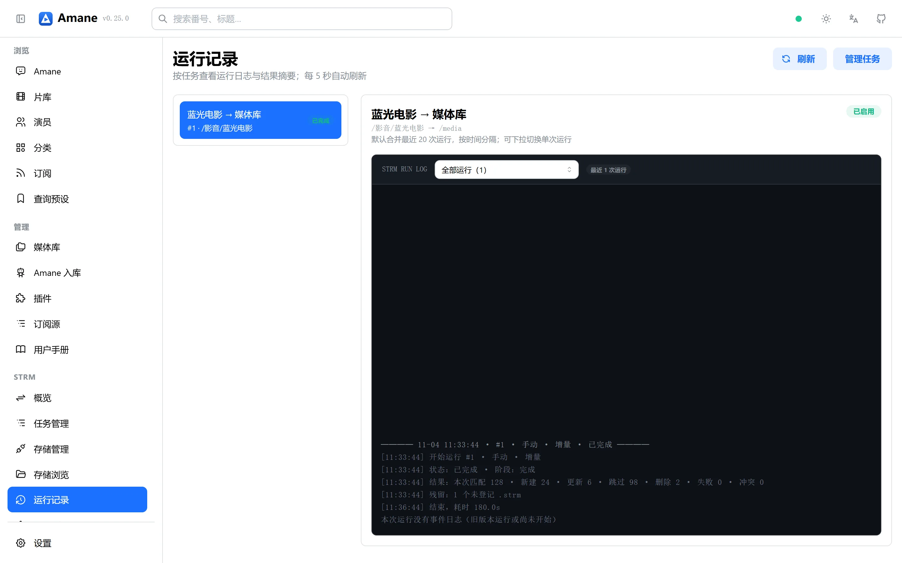
 </picture>
 <br><sub>STRM 运行记录：同步结果、失败项与运行日志入口</sub>
 </td>
 <td width='50%'>
 <picture>
 <source media='(prefers-color-scheme: dark)' srcset='assets/screenshots/compare-sources-dark.webp'>
 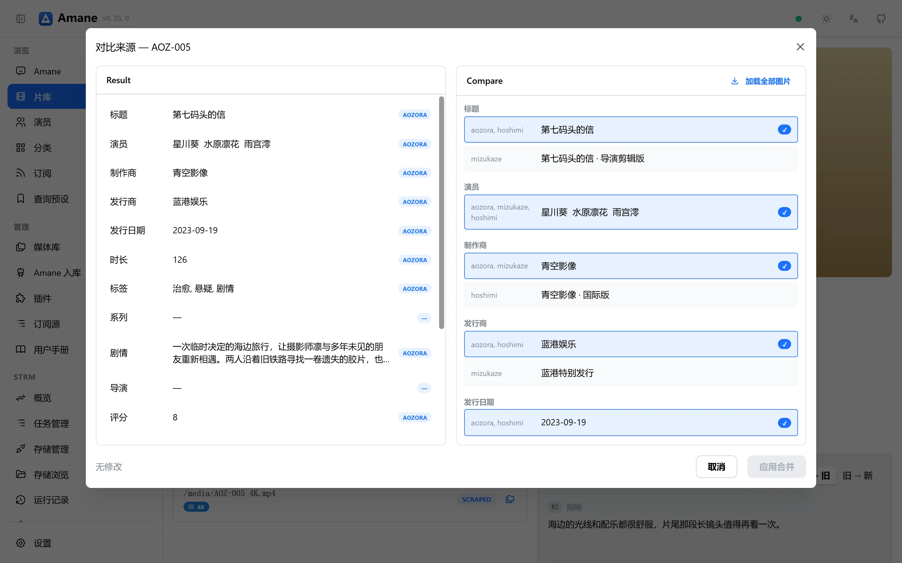
 </picture>
 <br><sub>多来源对比：逐字段查看不同来源并提供聚合评分</sub>
 </td>
 </tr>
 <tr>
 <td width='50%'>
 <picture>
 <source media='(prefers-color-scheme: dark)' srcset='assets/screenshots/acquisition-tasks-dark.webp'>
 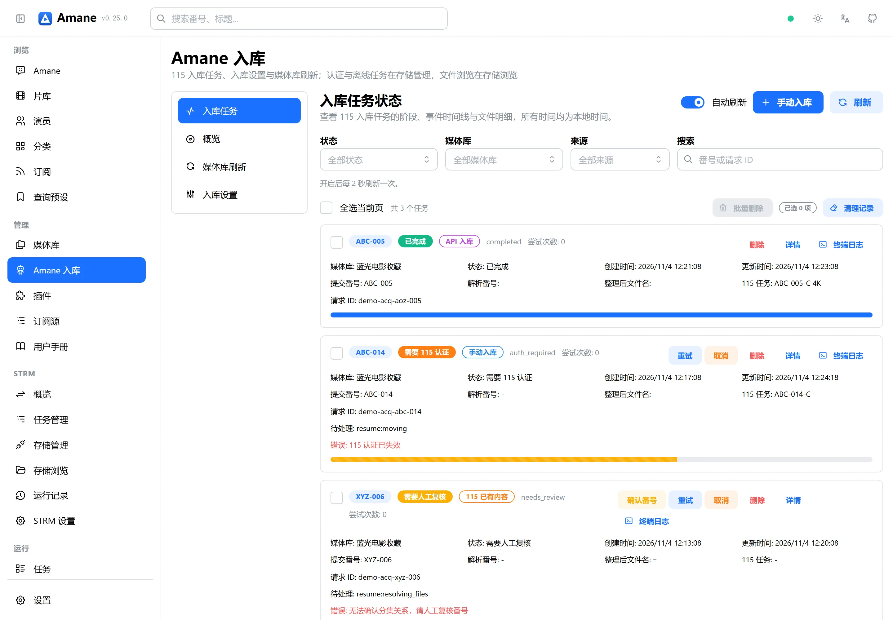
 </picture>
 <br><sub>入库任务：入库阶段、来源、进度与事件入口</sub>
 </td>
 <td width='50%'>
 <picture>
 <source media='(prefers-color-scheme: dark)' srcset='assets/screenshots/acquisition-terminal-dark.webp'>
 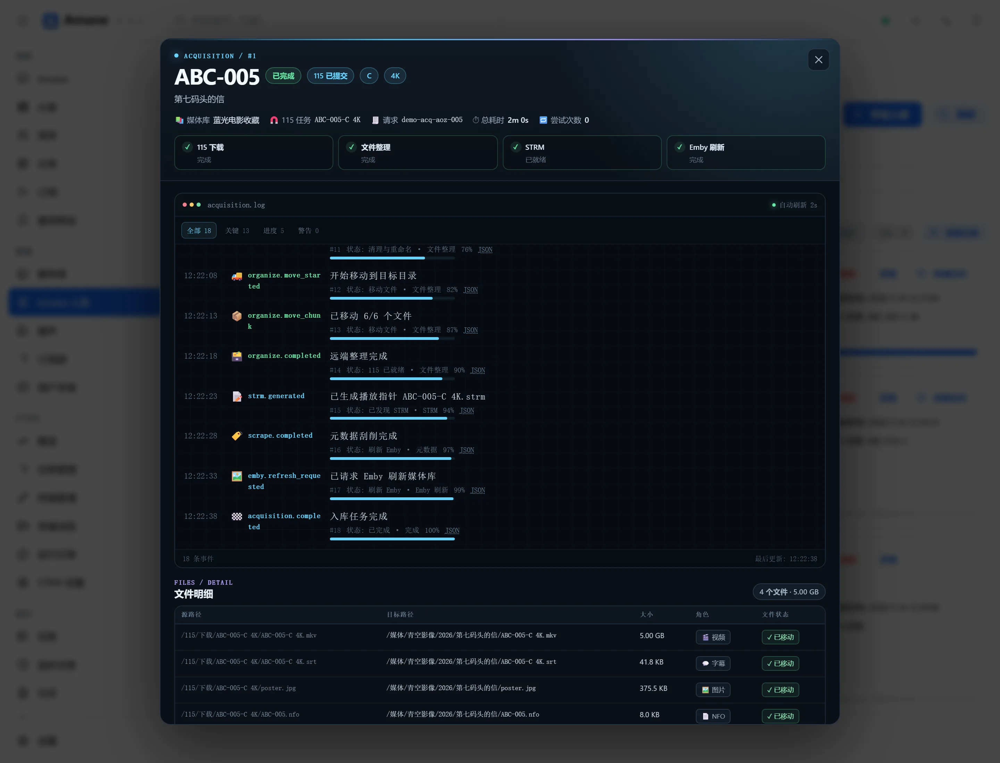
 </picture>
 <br><sub>终端日志：阶段、事件、文件明细与持续跟随</sub>
 </td>
 </tr>
 <tr>
 <td width='50%'>
 <picture>
 <source media='(prefers-color-scheme: dark)' srcset='assets/screenshots/storage-browse-dark.webp'>
 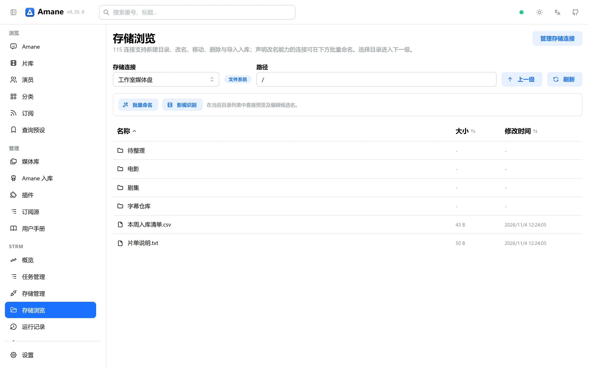
 </picture>
 <br><sub>存储浏览：目录分层、批量命名与影视识别入口</sub>
 </td>
 <td width='50%'>
 <picture>
 <source media='(prefers-color-scheme: dark)' srcset='assets/screenshots/playback-dark.webp'>
 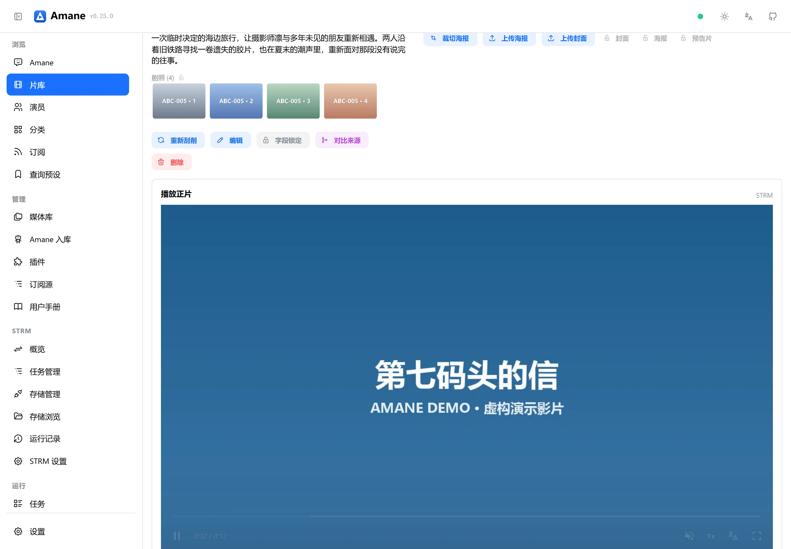
 </picture>
 <br><sub>302 正片播放：STRM 指针跳转到正片后由播放器直接加载</sub>
 </td>
 </tr>
</table>

## 典型使用方式

### 纯元数据管理

直接提交番号即可获得多源合并后的影片资料、演员信息和图片，不需要本地视频文件。

### 本地媒体库整理

为影片目录建立媒体库，扫描文件名识别番号，刮削后按模板整理并写出 NFO、图片和字幕，供 Emby / Jellyfin 使用。

### 115 / STRM 播放

管理 115 网盘内容，生成 STRM 指针，并通过 Emby 网关或播放代理访问远端媒体。

## 安装方式

| 平台 | 推荐场景 | 获取方式 |
|---|---|---|
| Docker | NAS、家庭服务器、需要长期运行 | `ghcr.io/zipenok/amane` |
| Windows 桌面版 | 在 Windows 电脑上单独运行 | 本仓库 Releases 中的 `Amane-v*-windows-x64.zip` |
| macOS 桌面版 | 在 macOS 13+ 上单独运行 | 本仓库 Releases 中的 `Amane-v*-macos.app.zip` |
| Android 客户端 | 访问已经部署的 Amane 服务 | 本仓库 Releases 中 `app-*` 开头的发布 |

完整步骤见 **[安装说明](docs/installation.md)**。

### Docker 快速开始

```bash
git clone https://github.com/ZiPenOk/Amane.git
cd Amane
cp .env.example .env
# 编辑 .env 与 compose.yaml 中的媒体目录
docker compose pull
docker compose up -d
```

启动后访问 `http://<主机地址>:8016`。API Token 位于宿主机数据目录的 `data/token`，也可以从容器日志获取。

需要从 115 或 JavBus / JavDB / JavLibrary 页面直接推送入库时，参见 [浏览器脚本与 Amane 入库](docs/browser-script.md)。

## 文档

- [安装与升级](docs/installation.md)
- [浏览器脚本与 Amane 入库](docs/browser-script.md)
- [首次使用](docs/quickstart.md)
- [与上游原版的主要区别](docs/differences.md)
- [故障排查](docs/troubleshooting.md)

## 项目关系

- **本仓库**：发行说明、用户文档与 `compose.yaml`
- **上游项目**：`sqzw-x/amane` 是项目最初的开源实现

该发行版包含个人维护者新增或调整的功能，因此行为可能与本仓库以外的版本不同。

## 许可与声明

本项目使用 [GNU General Public License v3.0](LICENSE)。

Amane 不提供、托管或分发任何影片内容。请仅管理你自行取得且有权访问的内容，并遵守所在地法律及服务条款。