# 与上游原版的主要区别

本发行版以 Amane 上游 `v0.25.0` 为基础，并持续同步上游更新；在此基础上增加了面向 115 入库、STRM、播放、整理和个人媒体库管理的功能。

> 本文截图使用完全虚构的影片、演员、制作商、评分和评论数据，仅用于展示界面。

## 概览

| 方向 | 上游原版 | 本发行版 |
|---|---|---|
| 115 入库 | 基础连接和文件处理 | 认证、浏览、已有文件导入、离线下发、远端整理、多库路由和完成状态跟踪的完整链路 |
| STRM | 基础指针生成 | 独立连接 / 计划 / 运行域、运行日志、TMDB 识别、批量改名、撤销、终止与残留清理 |
| 媒体修正 | 常规元数据编辑与整理 | 发布标记、条目类型、远端路径、本地 STRM、图片和 Emby 映射的一致性修正 |
| 播放与字幕 | 由媒体服务器负责播放 | STRM 直连播放、Emby 302 网关、字幕搜索 / 预览 / 加载 / 下载 |
| 数据源 | 上游默认来源 | 增加 JavDB App API、官方无码来源、演员头像缩略图缓存和多翻译源回退 |
| 界面 | 通用设置界面 | 媒体库主从式工作台、手动排序、STRM 工作台、任务日志终端 |

## 1. 115 / Amane 入库

本发行版把 115 入库从单点接口扩展为完整工作流：

- 115 登录、二维码认证和连接状态管理
- 文件浏览、目录快照、已有文件批量导入
- 115 离线任务创建、重试、删除和状态分组
- 多媒体库路由
- 按媒体库配置的文件夹、文件名和 FC2 专用模板
- 远端整理、重命名、STRM 生成和 Emby 刷新
- 任务失败、终止和清理后的收尾状态
- 在“Amane 入库”页面集中管理入库任务和媒体库刷新

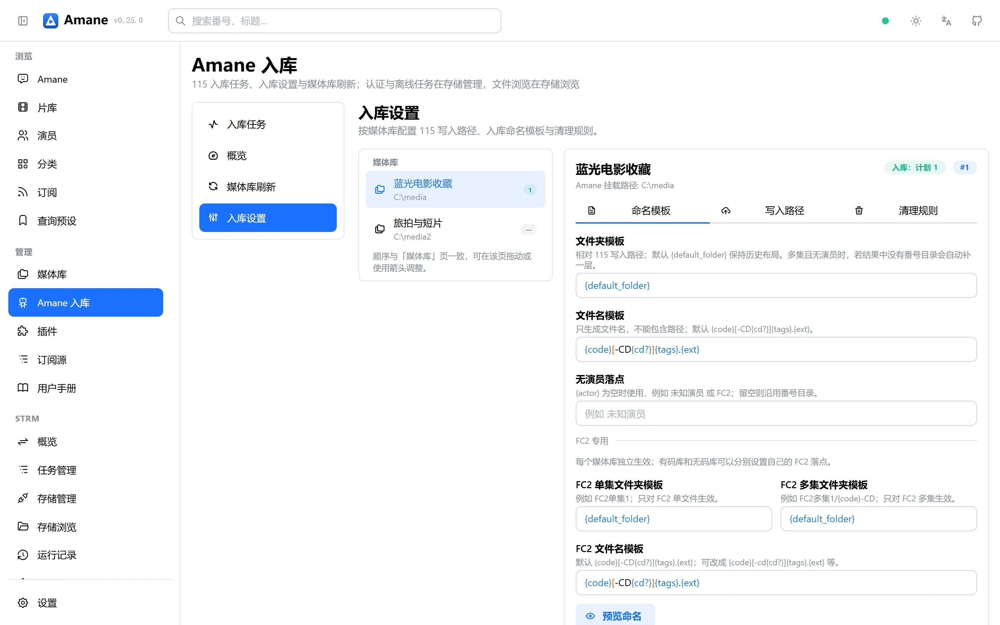

入库任务页集中展示阶段、来源、进度和事件入口，终端日志用于跟随入库、整理、STRM 生成与 Emby 刷新的完整过程。

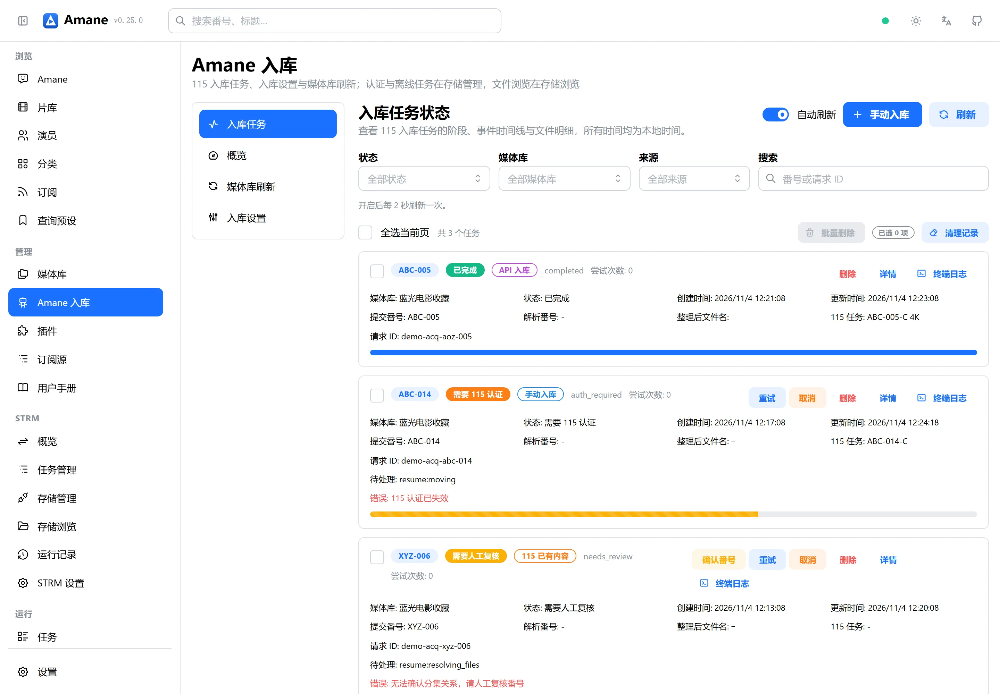

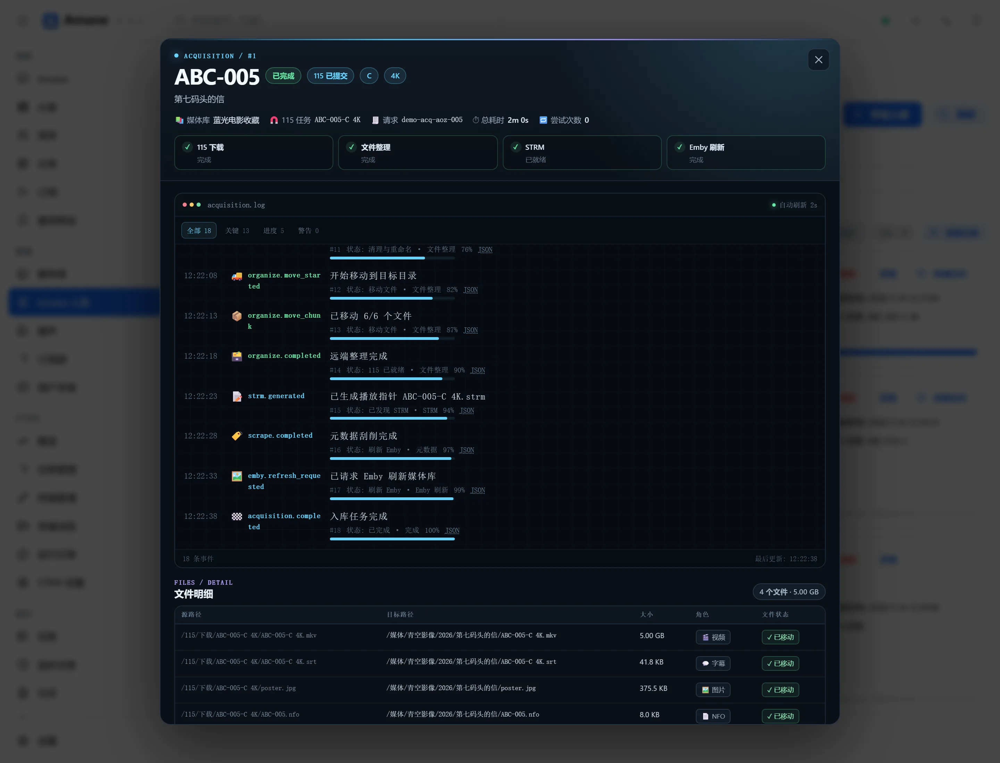

## 2. STRM 管理与批量改名

STRM 在本发行版中是一个独立功能域，而不只是整理任务的附属产物：

- 多存储连接：115、OpenList、WebDAV、文件系统
- 连接、同步计划、运行记录和逐条日志
- 增量、镜像、重建、重写和预览模式
- 已有 `.strm` 接管、残留清理和远端缺失检测
- 运行中可以终止任务
- 批量改名支持模板、正则、序号和 TMDB 识别
- 改名先预览，再分两阶段应用；已执行的改名可以撤销
- 显示改名会影响哪些同步计划，避免直接破坏现有指针
- STRM 直连播放和 Emby 302 网关

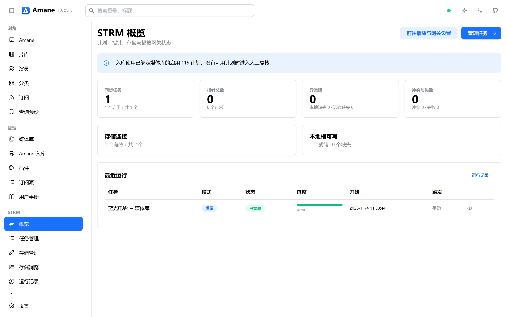

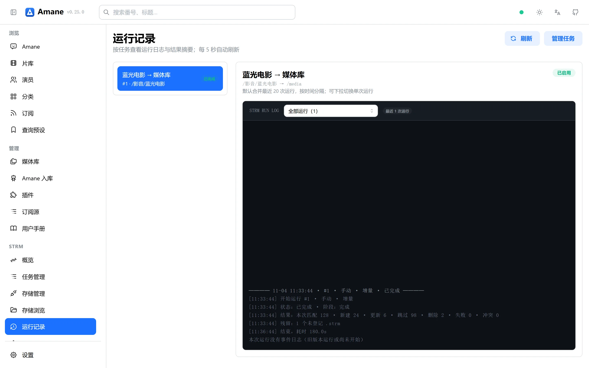

存储浏览支持目录分层查看，并把批量改名、影视识别等操作放在同一工作台。

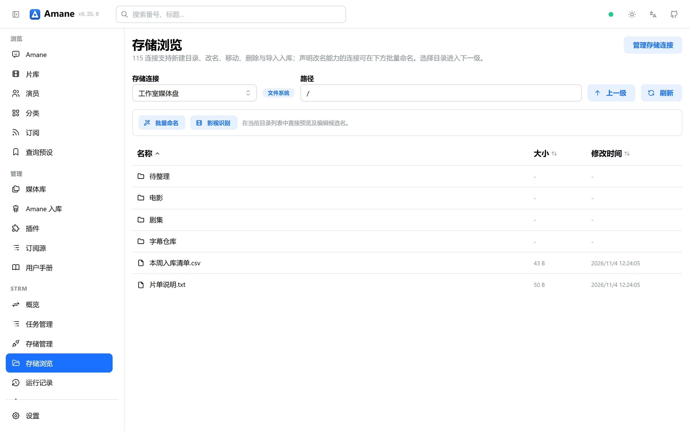

## 3. 媒体标记修正与整理

“修正标记与类型”会同时处理逻辑记录与磁盘产物：

- 修改发布标记，例如 `C`、`4K`、`VR`、`LTX`、`破解`、`流出`
- 修正有码 / 无码 / 欧美 / FC2 等条目类型
- 更新 115 远端文件名和路径
- 同步本地 STRM、NFO、图片和附属文件
- 重新生成图片水印角标
- 更新本地与远端映射，必要时修复缺失的 STRM 关系
- 支持单条和批量预检，先展示目标路径与冲突再执行

另外增加了独立的 LTX 标记和水印，与“破解”区分；也支持按媒体库关闭海报裁切。

## 4. 播放与字幕

除把 NFO、图片和字幕写给 Emby / Jellyfin 外，本发行版还增强了播放侧能力：

- STRM 直连播放
- Emby 302 网关
- 播放页字幕搜索与结果预览
- 从字幕来源加载字幕
- 下载字幕到媒体目录
- 自动匹配本地同名字幕
- 字幕位置、字号等显示调整
- 按视频文件与字幕标记配对，避免多分集影片错挂字幕

具体链路分为三种：

- **STRM 直连播放**：详情页请求 STRM 播放端点，Amane 返回 302，浏览器直接跟随到 STRM 内写入的正片地址，Amane 不转发媒体字节。
- **Emby 302 网关**：Emby 请求网关地址时，Amane 返回 302 到真实播放地址，适合能跟随重定向的客户端。
- **反向代理回退**：客户端没有 User-Agent，或播放器不跟随 302 时，切换为代理模式，由 Amane 转发媒体字节。

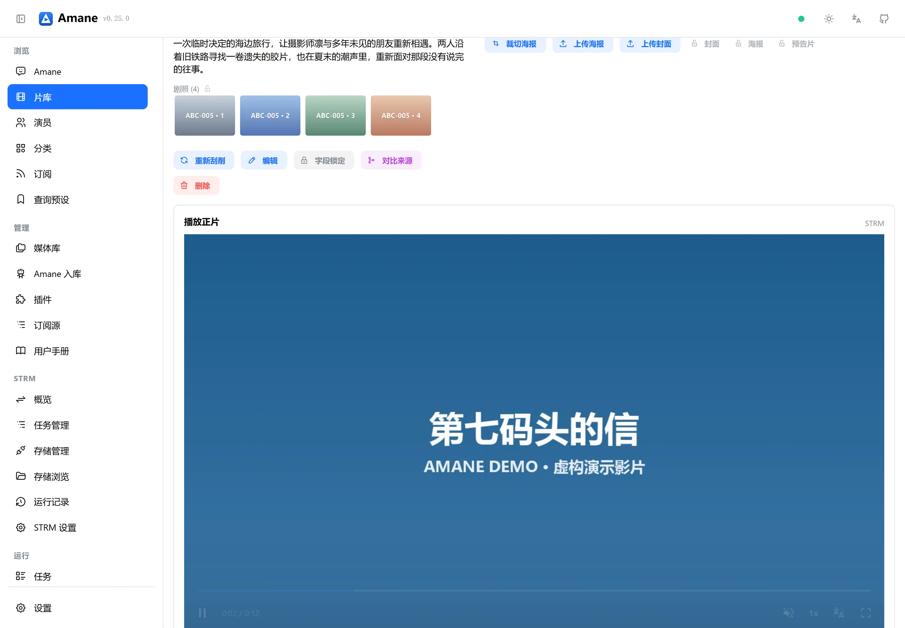

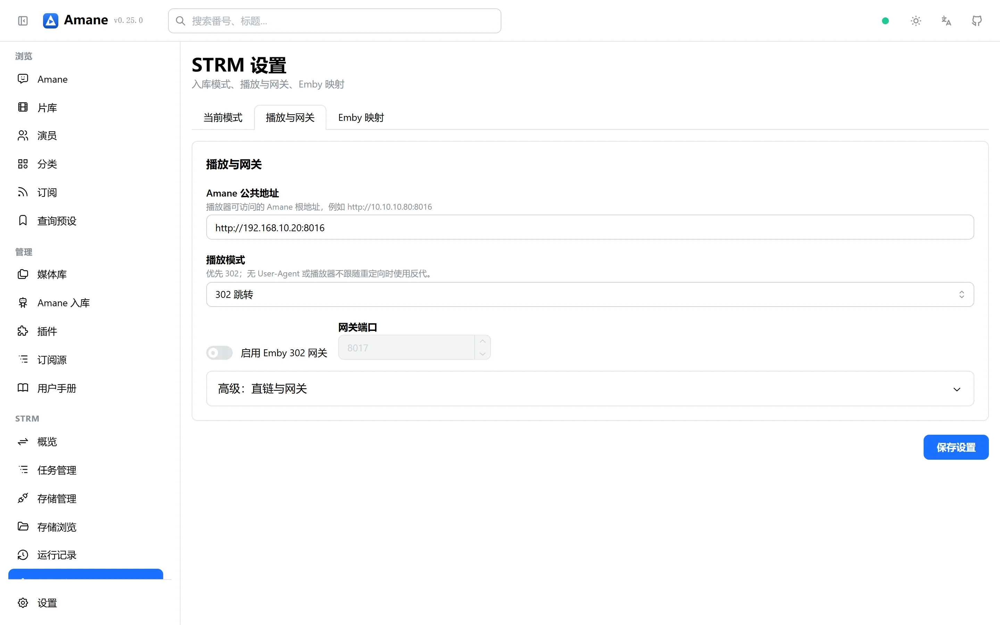

## 5. 数据源、翻译与演员

本发行版新增或强化：

- JavDB App API 作为独立刮削来源
- 官方无码来源
- 多翻译源回退：Google、Bing、DeepL
- 标题、剧情、演员名等文本字段的翻译覆盖
- JavDB API 演员资料来源
- 演员头像缩略图缓存，减少重复下载和大图占用
- 演员推送使用已落盘头像，不额外请求远端大图

> Emby / Jellyfin 演员资料与头像推送、语义检索本身来自上游 `v0.25.0`，不是本发行版的独有功能；本发行版主要增加了演员来源和头像缓存方面的增强。

## 6. 界面与性能

- 媒体库列表改为紧凑主从布局，并支持拖拽或箭头手动排序
- 媒体库刷新入口合并到 Amane 入库工作流
- 任务列表支持 STRM 运行事件、入库详情和持续跟随的日志终端
- 批量改名、媒体修正和 STRM 同步都有专用任务结果展示
- 优化 SQLite 常用查询、Watcher 子树查询和 115 目录缓存
- 115 文件浏览使用分层缓存，减少重复远端扫描

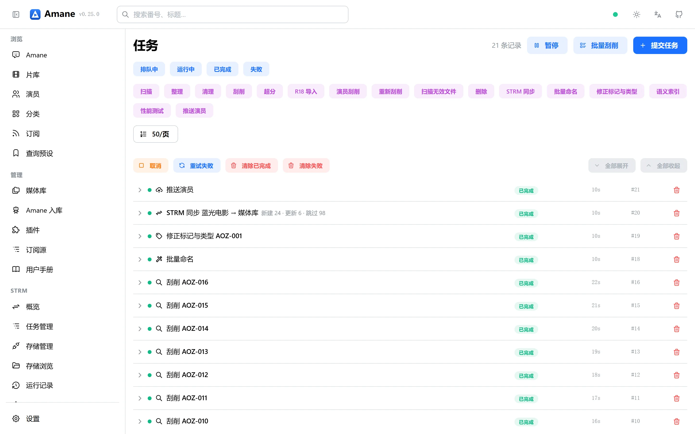

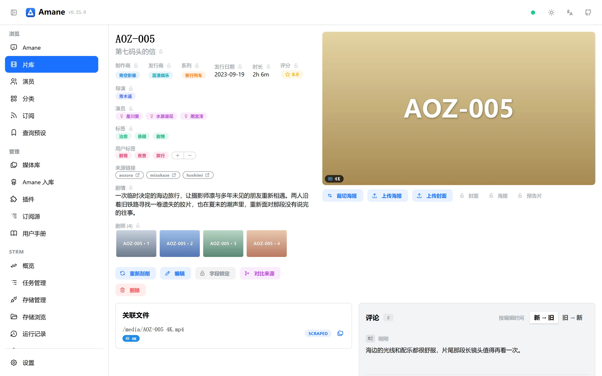

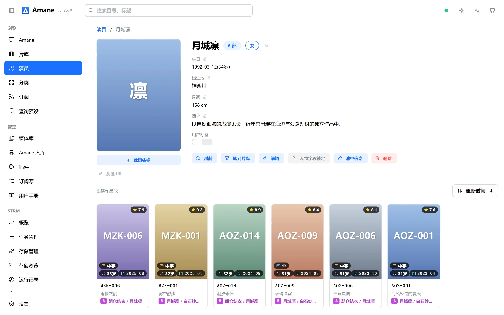

## 保持不变的基础

以下能力与上游保持同一设计方向：

- 多来源字段聚合与字段级优先级
- 原始站点快照、本地 SQLite 和资源目录
- 字段锁定、来源对比、分类和用户标签
- 任务树、订阅、定时任务和 AI 智能体
- Emby / Jellyfin NFO、图片、字幕和演员推送
- 语义索引与检索

本发行版会继续同步上游更新，并在同步后重新验证上述扩展功能。